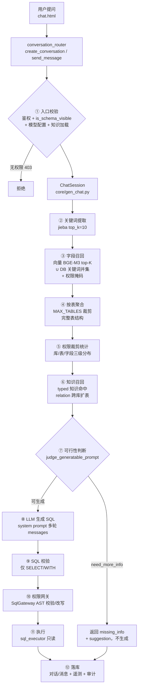

# NL2SQL 设计与实现

> 版本：v1.5（2026-10） · 读者：开发、算法调优、问题排查
> 本文描述 QueryForge 自然语言转 SQL 的完整生成链路：从用户提问到结果返回的每一步设计、关键代码位置、降级策略与调优参数。

---

## 1. 设计目标

1. **召回准**：字段级 RAG——先召回最相关的字段，再按表聚合成完整表结构注入 prompt，兼顾检索精度与上下文完整性；
2. **权限硬**：不可见的库/表/字段在召回阶段即被掩码过滤，生成后还有 AST 级网关兜底，双保险；
3. **不瞎猜**：信息不足时先判断再生成，返回缺失项与建议，而不是硬编一条错 SQL；
4. **可多轮**：追问轮复用首轮上下文 + 累积召回，历史 SQL 用过的表必留，上下文不膨胀；
5. **可观测**：每一步写入 `pipeline_log`，越权拦截、降级路径全程留痕。

---

## 2. 总体流程



| 阶段 | 代码位置 | 关键产出 |
|---|---|---|
| ① 入口校验 | `app/routers/conversation_router.py` | 403/模型客户端/知识文本/pre_log |
| ② 关键词 | `core/ret_keywords.py` | keywords（top 10） |
| ③ 字段召回 | `core/ret_retriever.py::recall_fields` | recalled_fields |
| ④ 表聚合 | `core/ret_retriever.py::aggregate_tables` | tables + all_fields |
| ⑤ 权限统计 | `core/gen_chat.py::_log_permission_stats` | STEP_PERMISSION 日志 |
| ⑥ 知识召回 | `core/ret_retriever.py::recall_knowledge` | prompt_text + related_tables |
| ⑦ 可行性判断 | `core/gen_sql.py::judge_generatable_prompt` | can_generate / missing_info |
| ⑧ LLM 生成 | `core/llm_client.py::chat` | sql + tokens |
| ⑨ SQL 校验 | `core/gen_sql.py::validate_sql` | is_valid / columns |
| ⑩ 权限网关 | `services/sql_gateway.py` | 放行 / 拦截 / 改写 |
| ⑪ 执行 | `services/sql_executor.py::execute_sql` | columns + rows |
| ⑫ 落库 | router + `services/telemetry.py` + `core/gen_audit.py` | 会话/消息/llm_calls/query_audit_logs |

---

## 3. 阶段详解

### 3.1 ① 入口校验（路由层）

`POST /api/conversation`（首轮）/ `POST /api/conversation/{id}/messages`（追问）：

1. **鉴权**：`CurrentUser` 依赖解析 token；
2. **库级可见性二次校验**：`is_schema_visible(user, schema_name)`——防绕过前端直接请求无权限库，失败 403；
3. **db_type 判定**：指定库取库自身类型；全库模式（schema_name=None）从用户可见库推断（供 prompt 引用符提示）；
4. **模型配置解析**（`_get_user_llm_client` 优先级）：请求指定 config_id（限本人或公共）→ 本人默认 → 公共默认（管理员公开的模型）→ 空客户端（后续调用报"未配置 API 密钥"）；
5. **知识加载**：用户勾选的多条知识 content 拼接（内容级去重）。

以上步骤作为 `AUTH_SCHEMA_CHECK / LLM_CONFIG_LOAD / KNOWLEDGE_LOAD` 写入链路日志头部。

### 3.2 ② 关键词提取（jieba）

`KeywordExtractor.extract(query, top_k=10)`：jieba 分词 + 停用词过滤 + TF 统计，取前 10 个关键词。

设计要点：**追问轮若无实质业务词**（如"不对，条件改一下"），提取结果为空——此时跳过向量召回直接复用首轮表集合（全库向量召回必然跑偏，召回过百无关字段反而污染上下文）。

### 3.3 ③ 字段召回（向量 + DB 并集）

`SchemaRetriever.recall_fields(keywords, schema_name, query)`：

```
1. 懒加载向量索引（try_load_vector_store）
   - 全库字段数 < 阈值(默认50) → 不走向量
   - 索引 status=stale → 用旧索引继续服务 + 后台懒重建，不阻塞请求
   - 无索引文件 → 前台构建（首问慢属预期）
2. 向量检索（search_vector）
   - 编码文本：优先原始 query（完整语义），回退关键词拼接
   - top_k = FIELD_RECALL_TOP_K（默认20）
   - 权限掩码：仅允许可见库字段参与 top-K 竞争（admin/无限制返回 None 放行）
3. DB 关键词召回（recall_from_db）——并集兜底
   - 关键词在 表名/字段名/描述 中子串匹配，按权限过滤，截断 top_k
4. 合并去重：同一字段以 DB 权威结构为准；向量来源标记 recall_source=vector（聚合加权用）
```

**为什么向量还要并 DB**：向量索引可能是历史构建的（缺新建库/权限范围不一致），仅靠向量会漏召回未建索引库的表；DB 子串匹配保证覆盖所有可见库。

### 3.4 ④ 按表聚合

`aggregate_tables(recalled_fields, schema_name, keep_first)`：

1. 召回字段 → 表名去重（保持输入顺序）；
2. 超 `MAX_TABLES`（默认 10）时**权重裁剪**：向量命中字段所在表权重 10、DB 子串命中权重 1，按权重保留；
3. `keep_first`（追问轮传首轮表集合）：首轮表完整保留，超限只裁剪新增召回表；
4. 取这些表的**完整字段结构**（含主键/外键/示例值），字段 key 带库名前缀消歧（`库名.表名.字段名`）；
5. 未召回任何表时兜底：取前 N 张可见表。

产出 `schema_csv`（表名,字段名,字段类型,字段描述,主键,外键）——**跨库模式表名带库前缀**（`库名.表名`），供 LLM 生成可路由执行的 SQL。

### 3.5 ⑤ 权限裁剪统计

`_log_permission_stats`：记录库级可见性、表级白名单覆盖、字段 SELECT/FILTER/NONE 分布，并按敏感级别列出敏感/机密字段名单——供审计核对"该拦的有没有被拦"。

### 3.6 ⑥ 知识召回与动态扩表

`recall_knowledge(query, scope_schema_id, exclude_contents)`：

- **typed 知识**（八种类型：note/terminology/calculation/relation/value_domain/convention/entity_map/sample_qa）按关键词匹配（SQL LIKE 粗筛 + 内存打分，limit 12），渲染为 `【领域知识】` 文本块注入 prompt；
- **relation 知识**：payload 中 left/right 两侧表名自动收集为 `related_tables`，经 `extend_aggregation_with_tables` **跨库扩表**（不过滤 schema_name，仅按权限裁剪）——实现"知识描述的表关系把分散在多个库的表自动纳入上下文"；
- 与用户勾选知识按 content 精确去重，防同一知识两次注入；
- 作用域 `scope_schema_id`：知识可绑定库或全局。

另有**人工表关系**（`db_table_relations`）召回：仅当两侧表都在上下文中时才渲染 JOIN 提示（另一侧不在上下文时给出连接条件会诱导模型使用不存在的表）。

### 3.7 ⑦ 可行性判断（need_more_info）

生成前先让 LLM 判断信息是否充足（`judge_generatable_prompt`）：

- **判断标准**：表覆盖 / 字段覆盖 / 过滤条件明确 / 聚合意图清晰 / 追问语义（结合对话历史，"只保留某列"类修改不判不足）/ 口语化但意图可推断不苛求；
- **输出**：JSON `{can_generate, reason, missing_info[], suggestion}`；
- **信息不足**：提前返回，前端引导用户补充，**不调用生成**（省一次 LLM 调用，避免硬编错 SQL）；
- **故障容错**：`call_llm_json` 解析失败 → 默认 `can_generate=true` 放行（宁可放过，不可误拦）；
- 追问轮传入最近 6 条对话历史，让判断基于上下文而非孤立追问文本。

### 3.8 ⑧ LLM 生成

**首轮**：`messages = [system(schema_csv+规则+领域知识+JOIN提示), user(query)]`。

System prompt 结构（`gen_chat._build_system_prompt`）：

```
你是一个专业的SQL生成助手。请根据用户的自然语言查询和表结构，生成正确的{DB}查询语句。

【表结构】
表名,字段名,字段类型,字段描述,主键,外键
...

【规则】
1. 仅生成SELECT；禁INSERT/UPDATE/DELETE等写操作
2. 列名/表名必须在提供的表结构中
3. 多表连接用JOIN，连接字段类型保持一致
4. 添加适当WHERE过滤
5. 用户修改意见→基于上一轮SQL修改
6. 维度层级过滤(必守)：维度列必须加WHERE，用户未指定用最高级父节点(根节点)，
   勿混用层级，遗漏任何维度列数据会翻倍
7. 禁止SELECT *，必须显式列出查询字段(防敏感泄露)

【领域知识】（可选）
...

【表关系（已人工确认的 JOIN 条件）】（可选）
left.col = right.col (INNER JOIN, 1:N) — 说明
多表查询时必须优先使用上述连接条件，不要自行猜测连接字段。

只返回SQL语句，不要包含其他解释文字。
```

> 第 6 条**维度层级规则**是业务刚需：维度表存在父子层级时，不过滤会把子孙节点与父节点汇总进同一结果导致数据翻倍。

**响应处理**：`_extract_sql` 剥离 markdown 代码块（` ```sql ` / ` ``` `）；空响应或异常由路由层转 500 错误信息。

**LLM 客户端**（`core/llm_client.py`）：

- 通用 OpenAI 兼容：`base_url` 自动补全 `/chat/completions`；
- `requests.Session` 连接池复用（pool 10，重试 429/502/503/504）；
- **SSRF 防护**：仅 http/https，禁止内网 IP 段与 localhost/0.0.0.0；
- 调用详情写 `llm.log` + 遥测库（`llm_calls` + `llm_prompts` 去重快照）。

### 3.9 ⑨ SQL 校验

`validate_sql`（第一道， prompt 层规则 + 正则）：

1. 必须以 SELECT 或 WITH 开头；
2. 禁写关键字：drop/delete/update/insert/alter/create/truncate（`\b` 词边界）；
3. 禁注释符 `-- # /* */`（视为注入）；
4. 解析 SELECT 列表字段供前端展示。

### 3.10 ⑩ 权限网关（AST 级，最硬的一道）

`services/sql_gateway.py`，sqlglot 解析 AST：

```
1. 解析（按 db_type 选方言）→ 失败直接拦截
2. 提取表名（跨库返回 库名.表名）
3. 加载权限：字段权限映射 + 行级规则 + 表级白名单
4. 表级校验：受限 schema 中白名单外的表 → 拦截「无权访问表 X」
5. 字段级校验（逐 Column，解析别名/库前缀，无前缀时全库平铺兜底）：
   - NONE            → 拦截「无权访问字段 X.Y」
   - FILTER 出现在 SELECT → 仅放行被 SUM/AVG/COUNT/MAX/MIN 整体包裹的用法
     （如 SUM(amount - qty*cost)）；裸列/算术/普通函数包裹一律拦截
6. 禁 SELECT * / t.*（COUNT(*) 等函数内星号放行）
7. 行级过滤注入：命中表自动 WHERE append（如 sales_region = '华东'），
   注入记录进 modifications
8. 有改写 → 按方言重新生成 SQL（was_modified=true）
```

设计要点：

- **admin 不整体跳过**：admin 同样受角色 DENY 约束，路由层已拦库级，网关做表/字段级兜底；
- 字段不在已知 schema 中（不存在）→ 跳过校验让数据库报错，避免误拦；
- 网关异常不阻断主流程（降级为放行 + 日志告警），优先保证可用性。

### 3.11 ⑪ SQL 执行

`services/sql_executor.py`：

1. `_validate_select_only`：非空、仅 SELECT/WITH 开头；sqlglot AST 判定写操作节点（INSERT/UPDATE/DELETE/DDL 等，覆盖换行/括号邻接等子串绕过），解析失败回退 WITH 内写关键字正则粗检；
2. **数据源路由**：`schema_name → DbSchema.datasource_id → DataSource`；跨库模式（全库）从 SQL 表前缀（`库名.表名`）解析目标库，取第一个库的数据源连接；无前缀且可见库唯一时兜底路由；
3. **引擎缓存**：按数据源 id 缓存 Engine，连接指纹（类型/主机/端口/库/用户/密码密文）变化自动重建，不每次 create+dispose；
4. 只读执行，取前 `max_rows`（默认 100）行；
5. SQLite 本地库（无数据源关联）走主库引擎；其他类型无连接配置 → 报错不执行。

### 3.12 ⑫ 落库与遥测

| 数据 | 位置 |
|---|---|
| 对话 + 消息（user/assistant，含 sql/columns/result_data） | 主库 conversations / conversation_messages |
| LLM 调用明细（token/耗时/状态/prompt 快照去重，cost 字段预留恒 0） | 遥测库 llm_calls / llm_prompts |
| 查询审计（问题/生成SQL/改写SQL/网关判定/**全链路 pipeline_log**） | 日志库 query_audit_logs |
| 链路后置步骤（SQL_EXECUTE / MESSAGE_PERSIST） | 回写 pipeline_log |

assistant 消息通过 `llm_call_id` 关联调用明细，首轮 schema 上下文 prompt 通过 `context_prompt_id` 关联去重 prompt 快照。

---

## 4. 多轮对话设计

### 4.1 首轮 vs 追问

| | 首轮 `process_first_message` | 追问 `process_followup_message` |
|---|---|---|
| 召回 | 完整流水线 | 重新提取关键词 + 召回（仅追踪）；**无实质词则跳过召回** |
| 上下文 | 本轮聚合的 schema_csv | **累积聚合**：历史 SQL 用过的表（必留）∪ 本轮召回表 ∪ 知识扩表 |
| 字段裁剪 | 完整表结构 | 白名单 = 历史 SQL 引用列（硬需求不裁）∪ 本轮召回列（软信号，去重+限幅），主外键自动补齐 |
| 历史窗口 | — | 连续相同 user 消息去重 + 滑动窗口（首轮 + 最近 5 轮） |
| 可行性判断 | 无历史 | 传入最近 6 条历史，结合上下文判断 |

### 4.2 上下文收敛（防膨胀）

追问轮曾出现 CSV 从 139 行涨到 293 行的问题（首轮表无条件全量继承）。现行策略：

1. **必留表**：历史 SQL 实际用到的表（`_extract_tables_from_sql`，sqlglot 解析，保留字表名如 `order` 也能正确识别，解析失败正则兜底）；
2. **召回列裁剪**（`_trim_recall_cols`）：
   - 同名列跨表只保留第一个（仅限长度 ≥8 的长复合列名如 `product_brand`；`status/name/id` 等通用短名列各表语义不同不去重）；
   - 未在历史 SQL 引用过的表每表最多 4 个召回列（防 brand 表整表灌入）；
   - 审计/删除标记类字段（created_by/updated_at/is_deleted 等）直接裁；
   - 已引用表的召回列不设上限（新维度可能落在任意已用表上）。

---

## 5. 降级与容错策略汇总

| 环节 | 故障 | 降级行为 |
|---|---|---|
| 向量索引加载 | 模型缺失/索引损坏 | DB LIKE 关键词查询 |
| 向量检索 | 编码失败 | DB 关键词查询（并集合并） |
| 索引 stale | 同步后元数据变更 | 旧索引继续服务 + 后台懒重建 |
| 知识召回 | SQL 失败 | 返回空（prompt 无领域知识，不阻断） |
| 表关系召回 | 查询失败 | 静默返回空 |
| 可行性判断 | LLM 异常/JSON 解析失败 | 默认放行进入生成 |
| 权限网关 | 处理异常 | **拦截本次查询**（fail-closed，2026-10-17 由放行改为拦截）+ WARNING 日志 |
| SQL 执行 | 连接失败/SQL 报错 | 返回 error 字段，前端展示，消息仍落库 |
| 审计写入 | DB 异常 | WARNING 日志，不影响主流程返回 |

---

## 6. 关键参数（系统设置可调，实时生效）

| 参数 | 默认值 | 说明 |
|---|---|---|
| `VECTOR_INDEX_THRESHOLD` | 50 | 字段数达到此值才构建向量索引（低于则 DB LIKE 足够快） |
| `FIELD_RECALL_TOP_K` | 20 | 字段召回数量 |
| `MAX_TABLES` | 10 | 单次查询聚合的最大表数 |

调参建议：Schema 字段少但查询复杂 → 降阈值（30）；库表非常多 → 提 MAX_TABLES（15-20）；检索精度不够 → 提 TOP_K（30-50）；检索慢 → 降 Top_K。修改路径：系统设置 → 向量索引参数。

---

## 7. 链路追踪（pipeline_log）

每一步以 `{step, timestamp, data}` 追加，最终 JSON 存入 `query_audit_logs.pipeline_log`，前端「安全审计 → 链路追踪」弹窗展示：

```
AUTH_SCHEMA_CHECK → LLM_CONFIG_LOAD → KNOWLEDGE_LOAD → PIPELINE_START
→ STEP1_KEYWORDS → STEP2_RECALL → STEP3_AGGREGATE → STEP_PERMISSION
→ STEP_RECALL_KNOWLEDGE → STEP_EXTEND_TABLES → STEP4_CONTEXT
→ STEP_JUDGE_PROMPT → STEP_JUDGE_RESULT → STEP5_RESULT
→ STEP6_VALIDATE → STEP7_GATEWAY → SQL_EXECUTE → MESSAGE_PERSIST
```

排查"为什么召回了这些表/为什么被拦/为什么判信息不足"，看这条链路即可，无需复现。

---

## 8. 已知边界与注意事项

1. **LLM 同步阻塞**：生成接口为同步 def（线程池执行），默认 timeout 300s，一个卡死的模型调用会占用线程 5 分钟——模型配置时把 timeout 调小（如 60-120s）；
2. **全库模式跨库 SQL**：LLM 偶尔漏带库前缀，仅当用户可见库唯一时自动兜底路由，多库场景需在 prompt 中强调或改用单库对话；
3. **FILTER 字段的聚合放行**：`SUM(a - b*cost)` 这类业务指标刻意放行（成本价不可见但可参与计算），裸列与算术直出一律拦截——这是"可用不可见"的边界，审计时重点关注；
4. **向量索引不跨请求缓存**：每次请求懒加载（读元数据 + 文件），stale 检查有 DB 查询开销；
5. **字段召回上限**：top_k 截断优先保留向量高相关结果，DB 兜底结果可能被截——超大规模 Schema 建议提高 Top_K；
6. **测试基准**：经典场景与验证测试结论见 `docs/NL2SQL经典场景测试报告.pdf`、`docs/NL2SQL验证测试报告.pdf`。

---

## 9. 结果可解释性（失败归因，2026-10-17）

设计原则：**用户看到的每个异常结果（空结果/信息不足/报错）都必须给出可行动的原因**，
不再只有后台审计知道真相。分四类归因：

### 9.1 空结果归因（`_permission_note`）

SQL 执行成功但 0 行时，assistant 消息的 `permission_note` 会追加原因（前端气泡展示）：

| 场景 | 用户看到 |
|---|---|
| 网关注入了行级过滤 + 0 行 | 「已按数据权限过滤 N 张表（…）；查询返回 0 行：数据权限行级过滤后无匹配数据（也可能数据本身为空或筛选条件过严）；如预期应有数据，请联系管理员确认行级权限范围」 |
| 无权限过滤 + 0 行 | 「查询返回 0 行：未匹配到数据，可能筛选条件过严或数据本身为空」 |
| 历史消息无归因提示 | 前端兜底展示「可能筛选条件过严或数据本身为空…」 |

### 9.2 「信息不足」的权限归因（`_permission_context_hint`）

召回阶段按库/表/字段三级权限**静默裁剪**，LLM 只能看到用户有权限的表结构——
问题涉及的表/字段无权限时判断步会报「信息不足」，用户无法区分是表述不清还是权限不够。
现在判断步返回 need_more_info 时自动检测权限因素并追加提示：

- 库/表授权为空 → 「当前账号未被授予任何数据访问权限（库/表授权为空），请联系管理员配置角色授权」
- 召回不到相关表 → 「未在您有权限的数据库中检索到与问题相关的表/字段：可能是问题涉及的表无访问权限，或该库元数据尚未同步…」
- 范围内有 NONE 级字段 → 「注意：当前范围内有 N 个字段因权限受限未纳入本次分析，可能与信息不足有关」

管理员不追加（其上下文即全量）。

### 9.3 LLM 失败分类（`_classify_llm_failure`）

此前统一 500「创建对话失败: {原始异常}」。现按关键词归类为用户可读原因：

| 异常特征 | 状态码 | 用户提示 |
|---|---|---|
| timeout / timed out / 读超时 | 504 | 模型响应超时，请稍后重试或更换模型 |
| 401 / invalid api key / unauthorized | 502 | 模型 API 密钥无效，请检查 API Key 配置 |
| 429 / too many requests / 限流 | 502 | 模型服务限流/访问量过大，请稍后重试或更换模型 |
| 未配置 API密钥 | 400 | 未配置模型 API 密钥，请先在模型管理页完成配置 |
| base_url 非法（SSRF 校验拒绝） | 400 | 模型 API 地址配置不合法 |
| no such column/table / unknown column | 500 | 查询引用了不存在的表/字段：可能是模型生成了错误字段名 |
| 其余 | 500 | 保留原始错误（截断 300 字符） |

欠费类（LLMArrearsError）在此分类之前独立处理（502 + 自动标记配置 arrears）。

### 9.4 权限静默行为明示（既有机制）

- 行级过滤注入（was_modified）与敏感字段聚合（hit_sensitive）提示原已支持；
- **本次修复**：跨库模式下行级过滤因「库名.表名 vs 纯表名」匹配失败而静默失效 → 两侧归一化后匹配；
- **本次修复**：追问轮 fallback 重建 schema CSV 未做权限裁剪（受限字段连同样例数据泄漏进 prompt）→ 补齐三级裁剪。

### 9.5 回归测试

`tests/test_result_feedback.py`（14 用例）：空结果归因分支 / LLM 失败分类 / SSRF IPv6（::1、
::ffff:127.0.0.1、::ffff:10.0.0.5 拒绝，公网域名/IP 放行）。

---

## 10. 2026-10-17 全库扫描：已修复问题清单

| 严重度 | 位置 | 问题 | 修复 |
|---|---|---|---|
| 高 | sql_gateway `_inject_row_scope` | 跨库前缀 SQL 与纯表名规则匹配失败，行级过滤**静默不注入**（越权看全表） | 两侧归一化纯表名 |
| 高 | sql_gateway `_check_table_permissions` | LLM 漏带库前缀时表级白名单查不到 schema_id 整体绕过 | `_table_schema_flat` 平铺兜底 |
| 高 | gen_chat `_apply_gateway` | 网关异常 fail-open，该请求跳过全部字段/表/行级校验 | 改 fail-closed 拦截 |
| 高 | llm_client `_validate_llm_url` | IPv6 回环 `[::1]` 与 IPv4 映射 `[::ffff:127.0.0.1]` 绕过 SSRF 校验 | 语义化判定 is_loopback/is_private 等 + 映射地址还原 |
| 高 | conversation_router `_rebuild_schema_csv` | 追问轮 fallback CSV 无权限裁剪，受限字段+样例值泄漏进 prompt | 补库/表/字段三级裁剪 |
| 中 | sql_executor `_validate_select_only` | WITH 分支子串匹配可被换行/括号邻接绕过 | sqlglot AST 写节点判定 + 词边界正则兜底 |
| 中 | sql_gateway `process` | 网关自身不做只读根类型断言，写拦截依赖执行层黑名单 | `_assert_read_only`：根必须 SELECT/UNION，全树无写节点（覆盖 SELECT INTO/CTE 藏写） |
| 低 | sql_gateway `process` | 同一 SQL 重复 parse 两次 | 复用首次解析 |
| 低 | app/cache `_hashable` | set 迭代序不稳定导致缓存键抖动 | 排序后转 tuple |
| 低 | app/utils.py | 指向不存在旧库的死代码，全项目无调用 | 删除 |
| 性能 | app/auth + middleware + limiter | 同一请求 token 解析（JWT+2 次 DB 查询）重复 3~4 次 | `resolve_request_user` 结果缓存到 request.state，全请求仅解析 1 次 |

### 10.1 已识别、待后续处理（按优先级）

1. **网关字段归属**：无表前缀列按 FROM 第一张表判定权限，多表 JOIN 同名列可能误判（建议基于别名作用域解析）；
2. **metric 授权混源**：`get_column_access_map` 将 metric 类型授权 resource_id 与 DbColumn.id 混用，撞 id 可能提权；
3. **DEBUG=True 出厂默认**：兼任限流开关与异常详情回显，生产忘改即限流失效+信息泄露；
4. **执行层无语句超时**：慢查询长期占连接；
5. **慢 SQL 计时字典泄漏**：以 id(conn) 为键，异常路径不清理（缓慢内存泄漏）；
6. **ret_keywords 停用词/自定义词冲突**：同词两表意图矛盾；
7. **auth 令牌有效期夹取**：配置超限静默回落 15 分钟而非夹到上限。

> 勘误（2026-10-18 实测）：此前列出的「schema_service TTL 缓存空转」为误报——
> `_meta_key(db, *args, **kwargs)` 签名已单独捕获 Session 参数，缓存键不含 db，
> 实测两次独立会话调用 `list_schema_names` 命中缓存（hits=1），无需修改。
> 同日已完成：~~llm_client 双实现~~（`call_llm_with_details` 已改为 `chat()` 单条消息封装，
> 请求/SSRF/欠费/usage 处理单一内核）。

### 10.2 架构整理（2026-10-18，高内聚低耦合）

| 改动 | 内容 |
|---|---|
| LLM 客户端去重 | `call_llm_with_details` 70 行实现删除，改为 `chat()` 的单条 user 消息封装——请求构造/SSRF/欠费识别/错误处理/usage 归一单一内核，杜绝两份实现行为漂移 |
| schema CSV 重建下沉 | conversation_router `_rebuild_schema_csv`（自行拼三级权限原语）删除，改用 `SchemaRetriever.build_full_schema_csv`——权限裁剪归属召回层，路由层不再接触权限原语，杜绝再次遗漏裁剪 |
| 判断步结果构造合并 | gen_chat 首轮/追问两处 need_more_info 返回块合并为 `_need_more_info_result`（含权限归因提示 + 审计落库统一 try/except） |
| 前端转义统一 | `escapeAttr`（JS 串上下文转义，补反斜杠处理）上移 app_common.js 全站共用，chat.js 私有实现删除；与 escapeHtml 的适用边界在源码注释中写明 |
| 加密失败拒绝保存 | `crypto.encrypt_secret` 删除「失败回退明文」——API Key/数据源密码加密失败直接抛错拒绝保存，绝不静默明文落库（调用方 llm_router/sync_router 500 返回） |

---

## 11. 安全审查（2026-10-18，全库 + 未提交变更重点）

审查范围：认证会话（JWT/密码/pwd_ts 失效）、越权（IDOR/水平垂直提权）、SQL 注入面（全部 LIKE/ORM 参数化确认）、SSRF、敏感信息泄漏（api_key 仅 mask 返回/加密存储）、前端 XSS、prompt→SQL 间接攻击面（知识内容注入仅影响本人/管理员发布，SQL 侧由网关拦截兜底）。

### 11.1 发现并已修复（本次变更引入）

| # | 类别 | 位置 | 问题 | 修复 |
|---|---|---|---|---|
| 1 | xss（存储型） | [knowledge.js](../static/js/knowledge.js) 版本按钮 | `onclick="openVersionModal(id, '${escapeHtml(k.title)}')"`——escapeHtml（text→innerHTML 实现）**不转义引号**，标题含 `');攻击代码//` 即在 onclick JS 串中断注入；按钮仅管理员可见 → 普通用户建知识标题 → 管理员打开列表即触发，配合 HttpOnly cookie 的 apiRequest 可冒用管理员会话调任意管理 API | onclick 只传 id，标题从当前页列表缓存 `_listItems` 取，textContent 渲染 |
| 2 | authz 绕过 | [knowledge_router.py](../app/routers/knowledge_router.py) restore | 恢复版本直接回写快照的 `visibility/is_pinned`，未走 `_validate_visibility_fields`——非管理员属主可借「曾为 global」的旧快照重新发布全局知识并置常驻，绕过仅管理员校验与 MAX_PINNED_GLOBAL=20 上限（需前置条件：该条目曾有 global 版本） | 非管理员恢复时强制降为 personal/取消 pin，管理员不受限 |

### 11.2 审查通过的面（无发现）

- **认证会话**：JWT alg 固定 HS256 + exp 校验 + pwd_ts 换绑（改密即全失效）；SECRET_KEY DB 优先且缺失即拒绝启动；bcrypt 存储含明文自动升级；
- **越权**：knowledge versions/restore/update/delete 均属主或管理员；user preferences 勾选校验可见性；permission_router 全部 AdminUser；对话/消息 admin 全量、用户仅本人；
- **SQL 注入**：全库动态查询均为 SQLAlchemy 参数化（含审计日志 like 搜索、知识召回 LIKE 下推——通配符仅影响召回广度非注入）；唯一字符串拼 SQL 的是行级过滤表达式，由管理员配置（受信方）且经 sqlglot 解析失败即跳过；
- **SSRF**：LLM base_url 语义化内网判定（含 IPv6/IPv4 映射）；数据源连接为管理员配置项；
- **敏感信息**：api_key Fernet 加密存储、接口仅 `api_key_masked` 返回；遥测/审计不记录密钥。

### 11.3 加固建议（2026-10-18 已全部落地，见 10.2）

1. ~~`crypto.encrypt_secret` 加密失败时回退明文存储~~ → 已改为失败即抛错拒绝保存；
2. ~~`escapeAttr`（chat.js 私有）~~ → 已上移 app_common.js 全站共用（并补反斜杠转义）。
