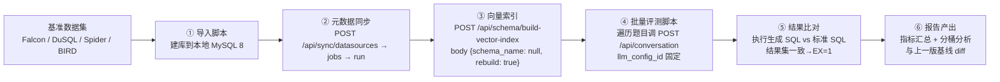

# NL2SQL 基准测试方案

> 版本：v1.0（2026-10-15） · 读者：开发、算法调优
> 目的：为 QueryForge NL2SQL 链路建立**统一的基准数据集与评测流程**。后续每次系统优化（召回策略、prompt、模型、网关等）前后均跑同一基准，用数据对比优化效果，避免凭个案感觉下结论。
>
> 候选数据集调研来源：DeepSeek 对话分享 <https://chat.deepseek.com/share/q4xnpmqzm9y0nt1zyt>（"还有那些 sql 题库 我想测试我的 nl2sql 效果咋样"）。

---

## 1. 评测指标

| 指标 | 定义 | 说明 |
|---|---|---|
| **执行准确率（EX）** | 生成 SQL 的执行结果集与标准答案一致则记 1 分 | 主指标，业界通用（Spider/BIRD 均采用） |
| 生成成功率 | 未被判"信息不足"、未报错、成功产出 SQL 的比例 | 区分"拦对了"和"没答出来" |
| 拦截正确率 | 判"信息不足"的题目中，确实无法从 schema 得出答案的比例 | QueryForge 特色：不瞎猜策略的代价与收益 |
| 端到端耗时 | 提问到结果返回（可行性判断 + 生成两次 LLM 调用） | 优化不能以耗时暴涨为代价 |
| Token 成本 | prompt_tokens + completion_tokens（含 reasoning_tokens） | 从 `llm_calls` 遥测表取，本地不计数 |
| 拦截/越权误伤 | 合法 SELECT 被网关拦截的次数 | 权限网关回归项 |

## 2. 基准数据集选型

### 2.1 候选全景（来自调研链接）

| 数据集 | 规模 | 语言 | 特点 | 适用性 |
|---|---|---|---|---|
| **Spider 1.0** | 约 200 库 / 10181 题 | 英文 | 学术最经典，跨域多表，官方榜 | ★★★ 主基准（dev 集） |
| **BIRD** | 大型真实库 | 英文 | 真实脏数据、需领域知识，工业界更看重 | ★★★ 主基准（dev 子集） |
| **WikiSQL** | 80000+ 问答对 | 英文 | 单表为主，过于简单 | ★ 鉴别度低，不采用 |
| **Spider 2.0** | 632 题 | 英文 | 企业级方言（Snowflake/BigQuery 等），SOTA 极低 | ★ 暂不采用，方言不匹配 |
| **DuSQL** | 23797 问答对 | 中文 | 中文跨域，值知识与注释贴近国内场景 | ★★★ 中文主基准 |
| **TableQA** | 64891 题 | 中文 | 中文表格问答，含聚合推理 | ★★ 子集可选 |
| **CSS** | 33620 问答对 | 中文 | 中文复杂 SQL | ★★ 备选 |
| **Falcon** | 500+ 题 | 中文 | 中文 SQL 竞赛题，难度分层清晰 | ★★★ 中文主基准 |
| **Archer** | 测试集 | 中英 | 专测"静默语义偏差"（SQL 对但结果错），SOTA 仅 6.73% | ★★ 专项回归，观察项不设 KPI |
| **NL2SQL-Bugs / DS-NL2SQL / ESQ-Bench（550 题）** | — | — | 专项缺陷/边角评测 | ★ 观察，暂不引入 |

### 2.2 本项目选型结论

结合 QueryForge 现状（MySQL 8 本地库、字段级 RAG 召回、中文注释元数据、doubao 系模型），分两档：

| 档位 | 数据集 | 题量 | 用途 |
|---|---|---|---|
| **A. 中文基准（主）** | Falcon 全量 500+ 题 | 500+ | 每次优化必跑，中文场景核心指标 |
| | DuSQL dev 子集 | 抽样 100 题 | 中文多表跨域 |
| **B. 英文学术基准（辅）** | Spider 1.0 dev | 抽样 100 题 | 跨域通用能力，结果可对标公开榜 |
| | BIRD dev | 抽样 50 题 | 真实数据鲁棒性 |

选型原则：

1. **Falcon 题量适中、难度分层、中文**，最贴合 QueryForge 主场景，作为每次优化的回归基准；
2. Spider 1.0 / BIRD 各抽子集，避免全量跑 LLM 的成本（全量 dev 跑一轮 doubao-pro 级别模型需数小时），抽样按题号等距取，**抽样规则固定写死**，保证前后对比用的是同一批题；
3. WikiSQL（太简单）、Spider 2.0（方言不匹配）、专项集（Archer/ESQ-Bench 等）列入观察项，不做常规回归。

## 3. 基准与 QueryForge 的对接方式

对接要点：

1. **数据集建库**：Falcon / DuSQL 为 SQLite/CSV 源，写一次性导入脚本转为 MySQL（统一 `benchmark_<name>` 库名）；Spider 1.0 官方提供 MySQL 方言版本直接导入；
2. **元数据注释**：导入时把建表语句注释写入 `COMMENT`（同步流程会自动带入 description，见现有 sync 链路）；中文数据集自带中文注释，英文数据集（Spider/BIRD）按官方 `tables.json` 的描述翻译补充；
3. **评测调用**：走真实 API 链路 `POST /api/conversation`（body 显式传 `llm_config_id: 4`），追问类题目走 `POST /{id}/messages`；
4. **超时与重试**：单题 LLM 耗时 77~140s，客户端 HTTP 超时设 ≥600s；偶发失败重试 1 次并记录；
5. **标准答案比对**：对每题同时执行标准 SQL 与生成 SQL，结果集行数 + 内容（排序敏感题保序比较，无序题多重集合比较）一致记 EX=1；生成 SQL 被判"信息不足"记 EX=0 并单独计入拦截桶。

## 4. 基线记录

优化对比必须有起点。基线两层：

### 4.1 内部基线（已有，手工验证）

| 轮次 | 数据集 | 场景数 | 结果 |
|---|---|---|---|
| 第一轮 | milk_tea_sales（自建 12000 单） | 7 场景（含多轮追问） | 7/7 与标准答案一致 |
| 第二轮 | northwind（8 表）+ sakila（12 表/20000 租赁） | 10 题 | 9/10 通过；S1 分类收入题因字段召回 TopK 遗漏 film_category 中间表被正确拦截，提示链路后复测通过 |

已知问题（纳入回归关注）：多轮追问的同步响应 message 为空（以持久化消息为准）；召回 TopK 可能遗漏中间关联表（S1 案例根因）。

### 4.2 正式基线（待建立）

第一次按本方案跑通 Falcon 500+ 题后，将结果固化为 **Baseline v0**（记录日期、模型 config、指标全量快照），后续所有优化对比均以 Baseline v0 及其后的最新基线为参照。

## 5. 优化对比流程

每次优化的标准动作：

1. 优化前：跑一轮基准（A 档必跑，B 档视改动范围），确认无未提交的环境差异（模型 config、向量索引状态一致）；
2. 优化后：同条件再跑一轮；
3. 产出对比表：指标 | 基线 | 优化后 | 差值，并对**回归题**（原对现错）逐题归因——回归题必须逐条给出根因或在报告中明确接受理由；
4. 报告存入 `docs/`，命名 `NL2SQL基准对比_<日期>_<优化项>.pdf/md`。

分桶分析维度（定位优化效果来源）：

- 按难度（Falcon 自带难度分层）；
- 按失败原因：召回遗漏（关联表/字段未进上下文）→ 可行性误拦 → 生成 SQL 错误 → 权限网关误伤 → 执行超时/报错；
- 按题型：单表聚合 / 多表 JOIN / 多轮追问 / 时间计算。

## 6. 附录：数据集获取

| 数据集 | 获取方式 |
|---|---|
| Spider 1.0 | <https://yale-lily.github.io/spider>（含 dev 集与 MySQL 方言脚本） |
| BIRD | <https://bird-bench.github.io/>（dev 集开放下载） |
| DuSQL | 论文《DuSQL: A Large-Scale and Pragmatic Chinese Text-to-SQL Dataset》 accompanying release |
| Falcon | <https://github.com/solidsea98/Falcon-Bench> |
| CSS / TableQA | 各自 GitHub 开源仓库 |
| Archer | ACL Anthology（论文页附数据链接） |
| ESQ-Bench | Zenodo 公开数据 |
