# QueryForge ChatSQL 流程图（Mermaid 源码）

> 对应 `app/routers/conversation_router.py`（对话 API）、`core/gen_chat.py`（ChatSession 生成链路）、
> `core/ret_retriever.py`（召回层）、`services/sql_gateway.py`（权限网关）、`services/sql_executor.py`（执行）。
>
> 2026-08-28 架构简化：`chat_to_sql_router.py` 与 `gen_pipeline.py` 已删除，
> 单轮/多轮统一走 `conversation_router → ChatSession` 一条链路；
> 创建对话不再要求选择数据库，schema_name=None 即全库模式（按权限自动决定数据范围）。

```mermaid
flowchart TD
    %% ===== 入口 =====
    U["用户在对话界面输入问题<br/>static/template/chatSQL/chat.html<br/>（无数据库选择，按权限自动决定）"] --> ENTRY{"请求入口"}
    ENTRY -->|"新建对话<br/>POST /api/conversation"| C1API["conversation_router<br/>create_conversation"]
    ENTRY -->|"跟进消息<br/>POST /api/conversation/{id}/messages"| C2API["conversation_router<br/>send_message"]

    %% ===== 鉴权 + 配置 =====
    C1API --> AUTH{"鉴权 + 库可见性<br/>is_schema_visible"}
    C2API --> AUTH
    AUTH -->|"无权限"| DENY["返回 403 拒绝"]
    AUTH -->|"通过"| CFG["构建 LLMClient<br/>用户模型配置 / 默认"]

    %% ===== 核心生成 =====
    CFG --> CS["ChatSession<br/>core/gen_chat.py"]
    CS --> GEN{"首轮 or 跟进"}
    GEN -->|"首轮 process_first_message"| F1["Step1 关键词提取<br/>KeywordExtractor"]
    GEN -->|"跟进 process_followup_message"| F0["复用对话历史<br/>+ 首轮表集合累积召回"]
    F1 --> F2["Step2 字段召回<br/>向量 BGE-M3 → DB 降级<br/>（全库模式跨库召回）"]
    F2 --> F3["Step3 表聚合 aggregate_tables<br/>（全库模式表名带库前缀 库名.表名）"]
    F3 --> F4["Step3.5 权限裁剪统计"]
    F4 --> SK["概念级召回 recall_knowledge → 动态扩表<br/>（relation 知识跨库扩表）"]
    SK --> SC["构建 schema_csv + 表关系 + system prompt"]
    F0 --> SC
    SC --> J{"Step4.5 可否生成 SQL 判断<br/>judge_generatable_prompt"}
    J -->|"信息不足 need_more_info"| ASK["返回 missing_info + suggestion<br/>前端引导用户补充，不生成 SQL"]
    J -->|"可生成"| F5["Step5 LLM 生成 SQL"]
    ASK --> AUD
    F5 --> VAL

    VAL["Step6 SQL 校验<br/>validate_sql"] --> GATE{"Step7 权限网关<br/>SqlGateway（跨库 key 消歧）"}

    %% ===== 权限网关 子流程 =====
    subgraph GW ["权限网关 (services/sql_gateway.py)"]
        direction TB
        G1["1 解析 SQL AST (sqlglot)<br/>提取 库名.表名 跨库标识"] --> G2["2 提取表 / 字段 + 子句上下文"]
        G2 --> G3["3 表级白名单校验"]
        G3 --> G4["4 字段级权限校验<br/>SELECT / FILTER / NONE"]
        G4 --> G5["5 展开 SELECT *"]
        G5 --> G6["6 注入行级过滤 WHERE"]
    end

    GATE --> GW
    G6 --> G7{"是否放行?"}
    G7 -->|"否"| BLOCK["拦截: block_reason<br/>is_valid = false"]
    G7 -->|"是 (改写)"| MOD["改写 SQL<br/>was_modified"]
    G7 -->|"是 (原样)"| OK["放行原 SQL"]
    MOD --> AUD
    OK --> AUD
    BLOCK --> AUD
    AUD["Step8 审计日志 write_query_audit_log<br/>pipeline_log 记录每一步（链路追踪弹窗）"] --> EX{"SQL 非空?"}

    %% ===== 执行 + 持久化 =====
    EX -->|"否（含 need_more_info）"| RESP["返回 SQL + 校验信息<br/>+ missing_info / suggestion"]
    EX -->|"是"| RUN["执行 SQL<br/>sql_executor（仅 SELECT，<br/>按 SQL 库前缀路由数据源）"]
    RUN --> RESP
    RESP --> SAVE[("持久化<br/>对话 / 消息 / 遥测 / 审计")]
    SAVE --> UI["前端渲染结果表格 + SQL"]
```

